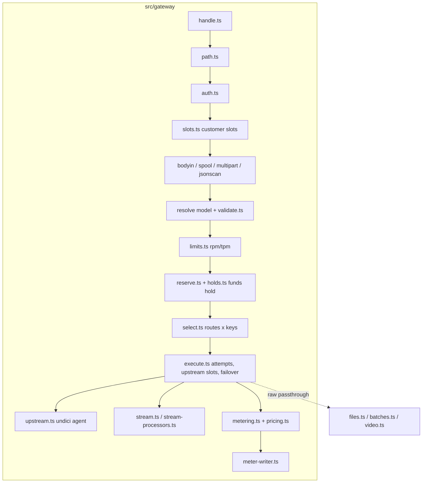

# Architecture

How ProviderProxy is built and how a request moves through it. The contract is [PLAN.md](PLAN.md). This document
describes the code as it stands.

## Components

| Component | Where | Notes |
|---|---|---|
| HTTP entry | `server.mjs` | Wraps Next's standalone `server.js`. It serves HTTP/1.1 and h2c (cleartext HTTP/2, prior knowledge) on one port by sniffing the first bytes. HTTP/1 request timeout is off, keep-alive is 620 s, and SIGTERM triggers a graceful drain. |
| Gateway route handlers | `src/app/v1/[...path]`, `src/app/v1beta/[...path]`, `src/app/upload/[...path]` | Thin wrappers (`runtime = "nodejs"`, `maxDuration = 800`) around `handle()` |
| Gateway engine | `src/gateway/` | `handle(Request) => Response`, framework agnostic, never throws |
| Provider adapters / drivers | `src/gateway/providers/` | URL + auth per preset (`adapters.ts`). Drivers handle non-OpenAI-shaped vendors: fal.ai (sync, falling back to queue), Replicate (predictions + polling) and fal video. |
| Translators | `src/gateway/translate/` | OpenAI chat <-> Anthropic Messages, requests, responses and streams; Claude reasoning mapping |
| Metering writer | `src/gateway/meter-writer.ts` | Batched, durable writes of `RequestLog` and balance debits |
| Billing | `src/server/billing/` | Stripe, ledger, top-ups, auto-recharge, postpaid, redeem codes, webhook, cron |
| Pricing rules | `src/server/pricing/` | Derives customer prices from pricing rules; default policy |
| Admin / customer server code | `src/server/admin/`, `src/server/customer/`, `src/server/analytics/` | Server actions and queries |
| UI | `src/app/admin`, `src/app/dashboard`, `src/app/(marketing)`, `src/app/(auth)` | Route guard in `src/proxy.ts` (Next 16 name for middleware) |
| Data | PostgreSQL 16 via Prisma 7 (`@prisma/adapter-pg`) | Money is `Decimal(24,12)` in USD; prices are USD per 1M units |
| Shared state | Redis 7 (optional) | Slots, holds, balance cache, rate limits, sticky responses, config invalidation. Each has an in-memory fallback. |
| Background jobs | `src/server/maintenance.ts`, optional `src/app/api/cron/{health,billing}` | Activity-driven by default (no timers, no pings); optional timers and Cloud Scheduler routes |

## Request pipeline (`src/gateway/handle.ts`)

1. **Request id.** A cuid is assigned and returned as `x-request-id` on every response, errors included. It is also
   the `RequestLog.id`.
2. **Path.** `parsePath()` maps the path and method to an inbound format, an operation, a required capability and
   the error shape (OpenAI / Anthropic / Gemini). It also collapses `/v1/v1/...`, maps `/v1/v1beta/` to `/v1beta/`,
   and maps Google's `/v1beta/openai/...` alias onto `/v1`. Unknown paths answer 404 and a wrong method answers 405,
   both in the shape the path implies.
3. **Auth** (`auth.ts`). The key is read from `Authorization: Bearer`, `x-api-key`, `x-goog-api-key` or `?key=`
   (the first `sk-pp-` value wins). It is looked up by sha256 in the 30 s cache. The checks: key ACTIVE and not
   expired, IP allowlist, user not suspended, email verified (when required), key spend limit, monthly spend limit.
   An IP that keeps sending bad keys is answered from the cache only and then gets 429. The effective pool is
   key group, else user group, else the default group.
4. **Customer slots.** Concurrency leases on the key, user and group pools that have `maxConcurrency` set. When none
   is set, the user pool with `defaultCustomerConcurrency` (20) is used. If a pool is full the request gets 429
   `rate_limited` with `retry-after: 1` immediately.
5. **Body.** The body is streamed and never buffered whole. An inbound `Content-Encoding` (gzip / deflate / br /
   zstd) is decoded. `maxRequestBodyMb` applies (0 = unlimited). Multipart bodies are spooled (memory up to 8 MB,
   then a temp file) and only the text fields are scanned. JSON is spooled, parsed once, and later forwarded as the
   original bytes with only the changed top-level members spliced in. Raw passthrough endpoints (Files, Batches,
   lookups) branch off before this step.
6. **Model.** The slug or alias is resolved and must be ACTIVE or HIDDEN (DISABLED is rejected). It must be allowed
   by the key and pool allow-lists and have the operation's capability. Video models without a per-second price are
   refused (fail closed). The price multiplier is computed as user multiplier x group multiplier.
7. **Limits** (`limits.ts`). Key RPM, group RPM (per customer) and key TPM. Exceeding one gives 429 with
   `retry-after` and `x-ratelimit-*`.
8. **Funds hold** (`reserve.ts`, `holds.ts`). The worst-case price is reserved before any upstream call; see
   [PRICING-AND-BILLING.md](PRICING-AND-BILLING.md#funds-holds). When funds are short the answer is 402
   `insufficient_balance` and the upstream is never contacted. When the client sent no output limit, an affordable
   one is written into the upstream request.
9. **Routing** (`select.ts`). The eligible routes are: route enabled, provider ACTIVE, provider tags matching the
   pool's `providerTags`, route `groupSlugs` including the pool, and the provider speaking the inbound format natively
   or through a translator. Order: route priority (desc), then native before translated, then provider priority
   (desc), then weighted random by route weight. Keys within a provider: usable keys only (ACTIVE, or COOLDOWN that
   has expired), then priority (desc), then weighted random. Sticky pins narrow the candidates: a Responses
   `previous_response_id` or a referenced `file_id` restricts them to the account holding the object.
10. **Upstream slots and failover** (`execute.ts`). The candidates are walked as (route, key) pairs. The first one
    with a free provider-key slot (and provider slot) wins. When everything is full the request waits in a queue
    for up to `queueTimeoutMs` (20 s) and then gets 429 `no_capacity`. Upstream 401 / 402 / 403 / 408 / 429 / 5xx /
    3xx, network errors and timeouts are recorded on the key (`keyhealth.ts`) and the next candidate is tried, up to
    `maxAttempts` (3), as long as nothing has been committed to the client. 4xx validation errors are passed through
    without failover.
11. **Response** (`stream.ts`, `stream-processors.ts`, `shape.ts`). Non-stream: usage is parsed, the body is
    translated back if needed, and the upstream model name is masked. Stream: the response is committed on the first
    upstream output event (or after one heartbeat interval of silence). Events are translated and masked, usage and
    TTFT are extracted, and `: keep-alive` comments are sent while the upstream is silent (`streamHeartbeatSec`,
    default 15). A stream is complete only when the upstream's terminal event arrived. If the upstream resets or
    closes early, the client connection is dropped the same way and no synthetic `[DONE]` is sent. When a stream
    reaches its funds hold, the upstream is aborted and the stream ends with a native `insufficient_balance` error
    event.
12. **Metering** (`metering.ts`, `pricing.ts`). Price, cost, profit and official price are computed from the usage
    (or a `js-tiktoken` estimate, `usageEstimated=true`). The entry is handed to the meter writer, the hold is
    settled, and the slots are released. A client abort gives `CANCELLED` (499) with the partial usage billed.

Errors are rendered in the inbound format (OpenAI `{"error":{...}}`, Anthropic `{"type":"error",...}`, Gemini
`{"error":{"code","message","status"}}`). Upstream errors are mirrored after failover is exhausted, with the last
upstream's status, `retry-after`, rate-limit headers and native error document, scrubbed of provider identity. There
are two deliberate exceptions. Upstream 401/402/403 become 503 `no_available_provider`, because they are our account
problems. Failures with no upstream answer become 502/504. The response header allow-list is in `headers.ts`.

### Transport rules (summary of PLAN 9d)

- No compression anywhere: Next `compress: false`, `Accept-Encoding: identity` upstream, and encoding headers are
  stripped.
- One shared undici agent with keep-alive, `connections: 10000` per origin and a 15 s connect timeout. The headers
  timeout is `provider.timeoutMs`, counted from the end of the request upload. There is no body timeout. The optional
  stream idle cutoff is `provider.settings.idleTimeoutSec`, else `upstreamIdleTimeoutSec` (default 0 = never).
- Upstream HTTP/2 is opt-in per provider (`settings.http2: true`, https only).
- Client disconnect aborts the upstream request immediately.
- URLs that come back from an upstream (fal / Replicate result files, video CDN links, redirects) are fetched only
  when they resolve to public addresses (`ssrf.ts`). The provider's own host is the exception, so self-hosted and
  mock upstreams work.
- `server.mjs` drops connections that send no bytes within 15 s, which defends against slowloris. The browser-facing
  app gets security headers (CSP `frame-ancestors 'none'`, `X-Frame-Options`, `nosniff`, Referrer-Policy,
  Permissions-Policy, and HSTS in production) from `next.config.ts`. Gateway paths (`/v1`, `/v1beta`, `/upload`) get
  none of these, so the proxy stays faithful.

## Translation (`src/gateway/translate/`)

| Inbound \ provider speaks | `openai_chat` | `anthropic_messages` | `gemini` |
|---|---|---|---|
| `openai_chat` | passthrough | chat -> Messages (incl. streams) | via Google's OpenAI-compatible endpoint (provider lists `openai_chat`) |
| `anthropic_messages` | Messages -> chat (incl. streams) | passthrough | Messages -> chat -> Google OpenAI-compat |
| `gemini` | not supported (`unsupported_endpoint`) | not supported | passthrough |
| everything else (Responses, embeddings, images, audio, files, batches...) | passthrough only | | |

`planTranslation()` picks native when the provider lists the inbound format. Otherwise it picks the translator. The
translators cover system prompts, multi-turn conversations, images (base64 and URL), tools and `tool_choice`, tool
calls and results, stop sequences, sampling params, `max_tokens`, streaming deltas (text, tool arguments), finish
reasons and usage. `claude-reasoning.ts` maps OpenAI `reasoning_effort` onto Claude thinking (budget or adaptive,
depending on the model profile). Native routes are preferred over translated ones at the same priority.

## Stateful objects

Some upstream objects live on exactly one upstream account. The gateway records the owner and the account and pins
every later call to that account. Foreign or unknown ids answer a native 404.

| Object | Store | Pinned by |
|---|---|---|
| Responses (`resp_...`) | Redis `responses-sticky` (30 days) with in-memory LRU fallback | `GET/DELETE /v1/responses/{id}`, `/cancel`, `/input_items`, `previous_response_id` |
| Files (OpenAI, Anthropic, Gemini), uploads, Gemini upload sessions | `UpstreamObject` kind `file` / `upload` / `gemini_upload` | File endpoints, plus any `file_id` / `fileData.fileUri` in chat / responses / messages / generateContent bodies |
| Files the upstream generated (Anthropic code execution, Responses code interpreter) | `UpstreamObject` kind `file` / `container_file` (`generated-files.ts`) | `/v1/files/{id}/content`, `/v1/containers/{id}/files/{file}[/content]` |
| Batches (Anthropic Message Batches, OpenAI Batch) | `UpstreamObject` kind `batch`; output/error files recorded as owned files | All `/v1/messages/batches*` and `/v1/batches*` calls |
| Video jobs | `VideoJob` table (public id `video_<48 hex>`) | `/v1/videos/{id}[/content]` |

Listings (`GET /v1/files`, batch lists, video lists) are served from our own records, so a shared upstream account
never leaks another customer's objects. A customer's new uploads prefer the account that already holds their files.
A request whose file references span two accounts is rejected with 400. Without Redis, Responses stickiness is
per instance and is lost on restart.

**Batches** (`batches.ts`): on create, every request in the batch is validated like a normal call. One bad request
rejects the whole batch with a native 400 naming its `custom_id`. All models must be served by one provider and the
batch runs on one upstream account. Each request gets the route controls a normal call gets (upstream
model name, provider `stripFields`, route `paramOverrides`, output cap). OpenAI input files are rewritten this way
and uploaded again on that account. One long-lived credit hold (30 h TTL) covers the worst case at the batch price. Results are
streamed through with models masked line by line. Each result is metered exactly once under a deterministic
`RequestLog` id (`batchLogId`). Metering is triggered by a status poll or results download that sees the batch ended, and by `sweepBatches()` in
every upkeep run. Deleting the batch, or its output file, is refused with 409 until it is metered. If a result's model is
no longer configured, metering is postponed rather than recording it unpriced. The hold is kept until the batch is
metered and then released.

**Videos** (`video.ts`): the job is charged at creation (seconds x per-second price). The first status poll (or the
upkeep's `sweepVideoJobs()`) that sees `failed` refunds the charge exactly once as a `REFUND` ledger entry.

## Caching and invalidation (`cache.ts`, `lib/settings.ts`, `lib/redis.ts`)

- One in-process **config snapshot** holds providers, keys (secrets decrypted lazily, once), models, routes, groups
  and settings. It has a 30 s TTL with stale-while-revalidate, so a warm instance never waits on the DB.
- **Auth records** (API key + user) are cached per key hash for 30 s, with a 3 s negative cache.
- **Balance** (`balance.ts`): the DB balance is cached and refreshed at most every 5 s. It is re-based whenever the
  meter writer commits a debit.
- **Invalidation**: every admin, billing or portal mutation calls `invalidateGatewayConfig(scope, id?)`. This clears
  the local caches and publishes on the Redis channel `config:invalidate`, so other instances drop theirs too.
  Without Redis, other instances catch up within the 30 s TTL.
- **Key health state** (cooldown, INVALID) applies to an in-process overlay at once, is broadcast to other
  instances, and is persisted to the DB coalesced every 1 s.
- Redis clients have no offline queue, so a command fails fast while Redis is down and the code falls back to
  memory.

## Metering writer (`meter-writer.ts`)

- Buffered in process and flushed every 500 ms or 200 entries in **one transaction**: `INSERT RequestLog ...
  skipDuplicates RETURNING id`, then aggregated updates of `User.balance`, `ApiKey.spent/lastUsedAt` and
  `ProviderKey.totalRequests/totalCost/lastUsedAt/consecutiveFailures`. Only inserted rows are applied, which gives
  exactly-once semantics with deterministic ids.
- A failed batch is retried with backoff (200 ms, 1 s, 3 s). Programming or data errors go straight to per-row
  isolation, so a poison row cannot block the others. While the DB is unreachable the buffer is kept, and after a
  30 s outage it is spilled to disk.
- A row that still cannot be written is **dead-lettered**: appended to
  `$METER_DEADLETTER_DIR/providerproxy-meter-deadletter.jsonl` (default: the OS temp dir) and logged as
  `METER_DEAD_LETTER` with severity ERROR and the full row. Its balance debit is applied through a minimal fallback
  update when possible (`debited: true`).
- The file is replayed 3 s after start-up and by every upkeep run (`replayDeadLetters()`). Rows are
  inserted with skipDuplicates, and already debited rows do not touch balances again. A row that fails 10 replays
  moves to `providerproxy-meter-poison.jsonl` (`METER_DEAD_LETTER_POISONED`).
- On SIGTERM or exit the buffer is flushed (up to 8 s) and the rest is spilled to the dead-letter file.
- After a flush the writer settles the holds (`holdsFlushed`), publishes the new balance, and calls
  `triggerAutoRecharge` / `maybeSendLowBalanceAlert`.

## Holds

`holds.ts` keeps per-customer reservations. In Redis this is the hash `hold:{userId}` plus the authoritative balance
string `bal:{userId}`, reserved atomically by a Lua script. In memory the semantics are identical. Amounts are
integer micro-USD (holds rounded up, balances rounded down). The lifecycle is reserve, then settle (the hold becomes
a pending debit until the meter writer commits it), or release. Each hold has an expiry renewed by a heartbeat while
the request is alive, so a crashed instance cannot leave funds locked. Batch holds are long-lived (30 h) and are
re-placed by the batch sweep.

## Concurrency slots (`slots.ts`)

This is a distributed counting semaphore. The pools are `key`, `user` and `group` (customer side) and `pkey` and
`provider` (upstream side). In Redis each pool is a sorted set `slots:{kind}:{id}` (lease id with expiry), acquired
all-or-nothing by one Lua call. Leases live 60 s and are renewed every 20 s, so leaks self-heal. In memory the
semantics are identical. Admins see live usage at `GET /api/admin/slots` (provider page, auto-refresh).

## Background jobs

Cold by default: `upkeep` (health from traffic, video/batch sweeps, dead-letter replay, history pruning) and `billing`
(auto-recharge, postpaid, stale payments) run as a side effect of activity (`noteActivity()` from the gateway after
authentication and from the admin layout), throttled to every 5 minutes / hourly. `probes` (uptime pings) run only
on a timer and only with `activeHealthChecks`. With `backgroundJobs` / `activeHealthChecks` on, an in-process timer
(armed at start-up by `src/instrumentation.ts` and whenever settings change) runs them on the admin's intervals. The
`/api/cron/health` and `/api/cron/billing` routes (`Authorization: Bearer $CRON_SECRET`) run the same jobs for Cloud
Scheduler. Runs are claimed atomically in `JobRun`. Details: [OPERATIONS.md](OPERATIONS.md#background-jobs-cold-by-default).

## Other HTTP endpoints

| Path | Purpose |
|---|---|
| `GET /api/healthz` | `{ok, db, redis, time}`. Only the DB gates readiness (503 when down). |
| `POST /api/stripe/webhook` | Stripe events, signature verified, idempotent |
| `GET /api/pricing[?group=slug]` | Price list (official vs customer price), CORS `*`, cached 60 s when public; with a valid API key it is always served (the key's own prices, `private, no-store`) |
| `GET /api/admin/slots` | Live slot snapshot (admin/support session) |
| `/admin/{logs,analytics,customers}/export`, `/dashboard/{logs,usage}/export` | CSV exports |
